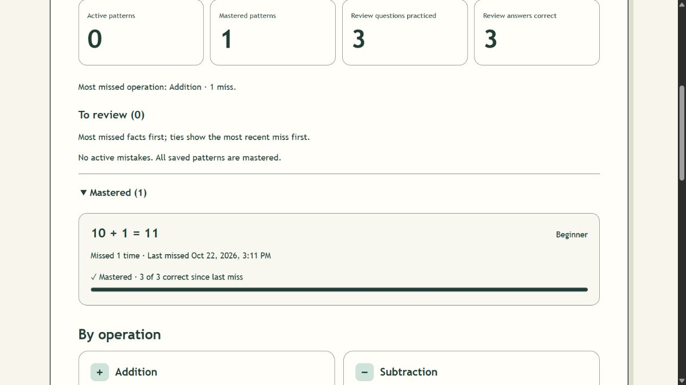

# Math Practice App AI Interaction Evidence

Gavin | CSE4095 | Individual Project | October 22, 2026

This selection records implementation, refinement, and testing interactions from the Math Practice App project. User prompts below are verbatim excerpts from the conversation. Outcome descriptions are summaries supported by the repository development and testing records, not reconstructed assistant transcript quotations. The screenshot is application verification evidence, not a screenshot of the conversation.

Repository: https://github.com/Hab1yer/math-practice-app

Application: https://math-practice-app-pi.vercel.app/

## Initial implementation request

User prompt recorded October 15, 2026:

> Read handoff.md and continue from the immediate task.

The agent read the handoff, recovered the specification and TODO list, and limited initial implementation to Phase 1. It initialized the repository, created a React/TypeScript foundation, configured code-quality and testing tools, and verified a production build and the initial screen. Later “proceed” requests advanced the next identified phase.

Supporting record: docs/DEVELOPMENT_LOG.md, “2026-10-15 — Phase 1 started” and “Phase 1 implementation and verification”. Foundation commit: 6d8638c. The first phase had one passing component test; this historical count is separate from the final 335-test result.

## Feature implementation and refinement

User prompt recorded October 22, 2026:

> Can we continue phases 13-16 please and leave the testing after

The agent implemented related arithmetic questions, prioritized mistake-review sessions, configurable mastery, advanced mistake statistics, and keyboard/accessibility improvements. Similar questions retained their source mistake so correct review reports advanced the appropriate pattern. Three correct review answers were the default mastery threshold. Behavioral tests were prepared but explicitly left unexecuted at this stage.

Follow-up user prompt:

> Please proceed with the rest of the phases

The final pass implemented session recovery and navigation protection, completed deferred tests, fixed discovered regressions, and prepared version 1.0.0. This demonstrates a changed development order followed by explicit verification.

Supporting record: docs/DEVELOPMENT_LOG.md, “Phases 13–16 implementation; testing deferred” and “Phases 17–22: first release preparation”. Release implementation commit: ae5e06c.

<!-- pagebreak -->

## Debugging and adversarial testing interaction

User prompt recorded October 17, 2026, including the original spelling:

> test the live browser verificatiton again and do an adversarial test

The agent retried previously blocked live verification. A five-card mixed session produced five attempts, three self-reported correct, and two incorrect. Double-clicking a result counted exactly once and left the next card unselected. Continuous-session checks covered cancellation, keyboard containment, focus restoration, and excluding an unreported card when ending.

The automated adversarial work included a reproducible 1,000-answer sequence interleaved with malformed, stale, duplicate, and conflicting reports. StrictMode tests submitted competing actions in a single event. The full check ultimately passed 169 tests and the production build for that revision. No production defect was reproduced in that particular pass; a TypeScript error in a test query was fixed. This historical result does not replace the later release result.

Supporting record: docs/DEVELOPMENT_LOG.md, “2026-10-17 — Live browser retry and adversarial tests”; docs/TESTING.md, Phase 7 retry record.

## Later bug and regression evidence

During release verification, production-router testing found automatic completion blocked by stale session state. Cancellation focus was also attempted before inert content became interactive again. The agent fixed these behaviors and added regression coverage. The exact development-log outcome includes:

> Tests and live production-preview work exposed/fixed completion/navigation races, cancellation focus timing, router-aware skip navigation and asynchronous lazy-page test queries.

This quotation is from the agent-maintained development log, not a verbatim chat response. The subsequent browser review ended automatically on mastery, retained totals after a completed-state reload, and restored focus after cancellation.

Supporting records: docs/DEVELOPMENT_LOG.md, “Phases 17–22: first release preparation”; docs/TESTING.md, “Phases 17–22 release verification”; docs/RELEASE.md. Release verification documentation commit: 3f3c327.

## Evidence boundaries

The final recorded check passed 335 tests in 32 files, lint, formatting, strict TypeScript, and the production build. Browser actions were agent-operated. Actual screen-reader, other-browser, physical-device, true zoom/system-font, and full browser-process restart checks remain open. This evidence does not claim those checks were completed or that every test was repeated manually by the student.

<!-- pagebreak -->

## Application verification screenshot

The production-preview screenshot below shows zero active mistakes, one mastered mistake, and three correct review answers out of three review attempts. The expanded mastered fact is 10 + 1 = 11. Overall totals of eight attempts, seven correct, one incorrect, and 88% accuracy were recorded separately in docs/TESTING.md. This capture supports the mastery outcome after the completion-navigation fix.

Source: docs/verification/release-mastery-desktop.jpg, captured during the October 22, 2026 release verification. This image documents a local production preview; separate hosted-route checks are recorded in docs/TESTING.md.

## Repository evidence locations

The repository preserves docs/DEVELOPMENT_LOG.md for prompts and decisions, docs/TESTING.md for observed results and regressions, docs/TODO.md for phase status, and docs/RELEASE.md for the release checklist and remaining checks. Git history records incremental implementation rather than a single final upload. The supplied example transcript is not presented as evidence of this project's work.
